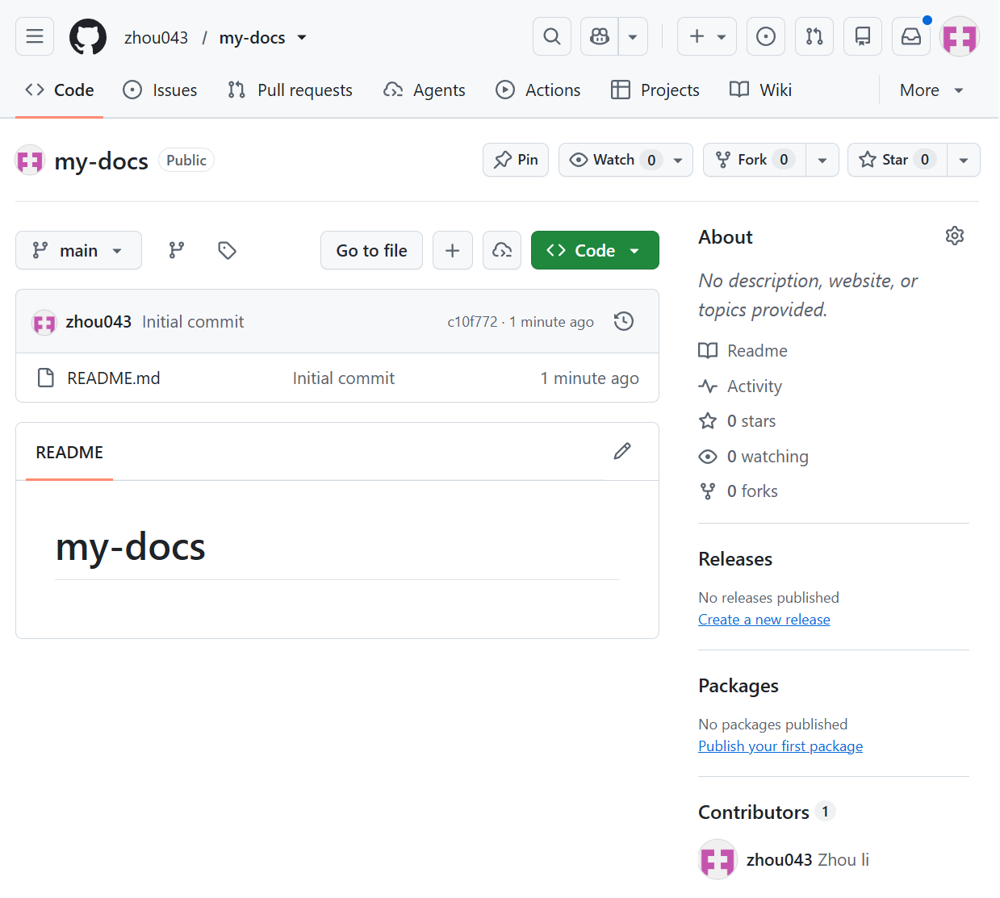
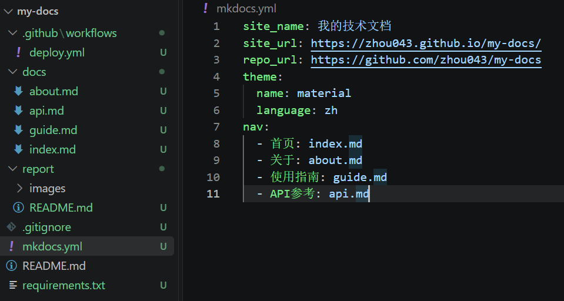
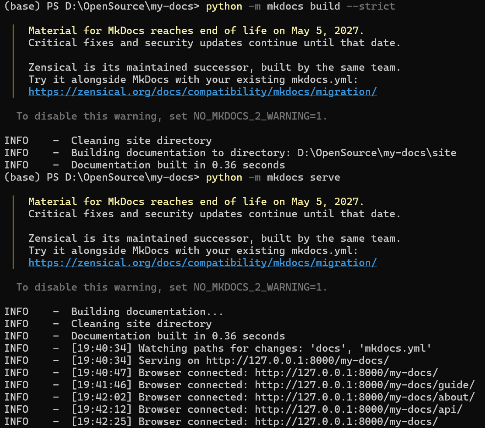
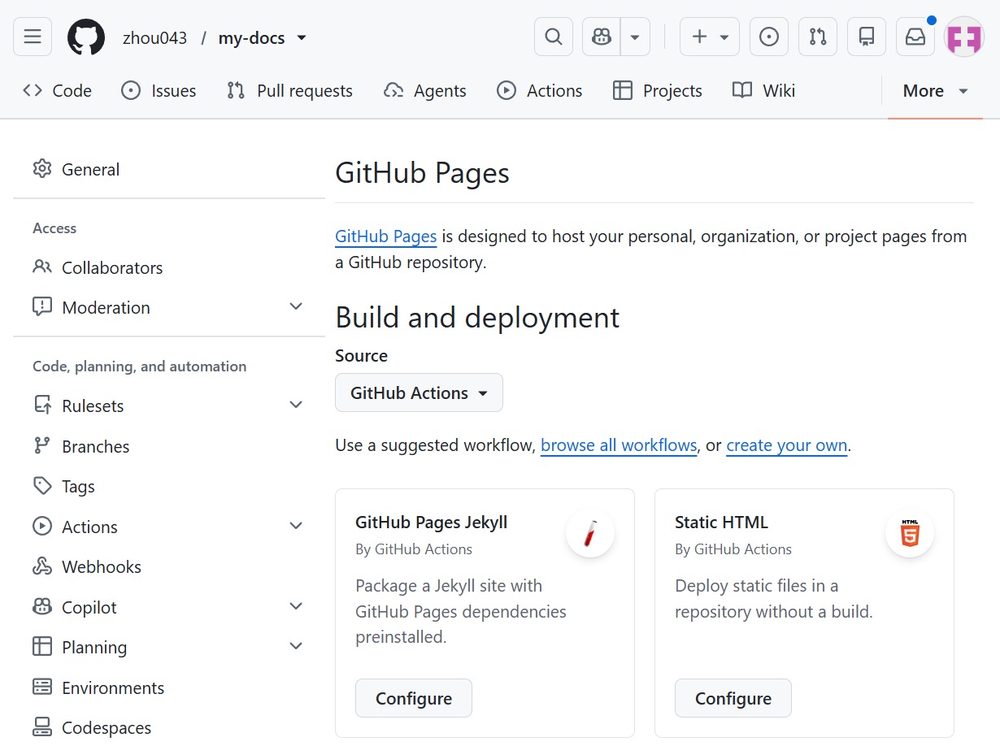
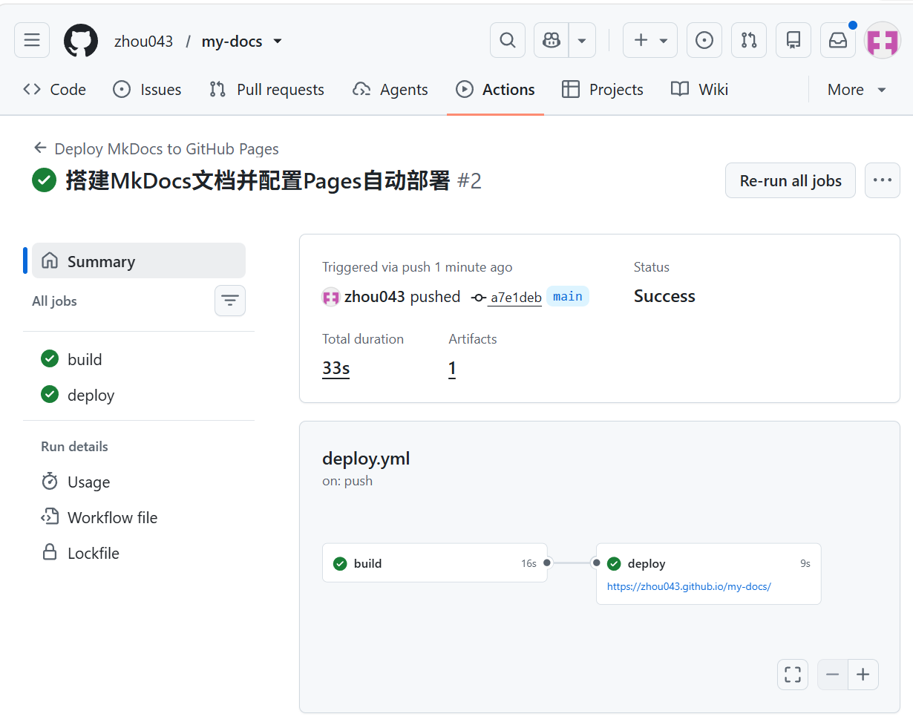
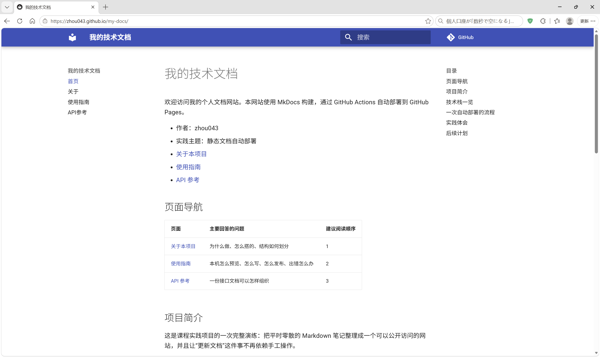
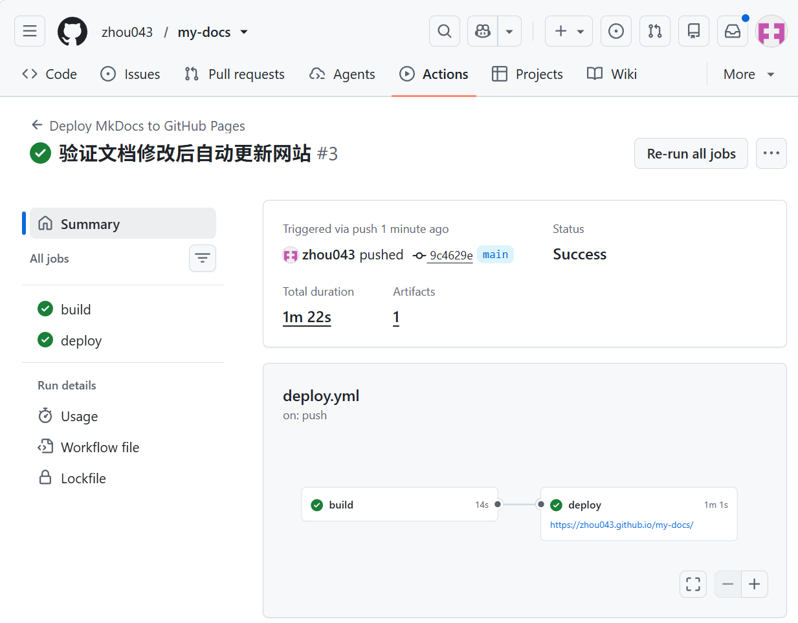
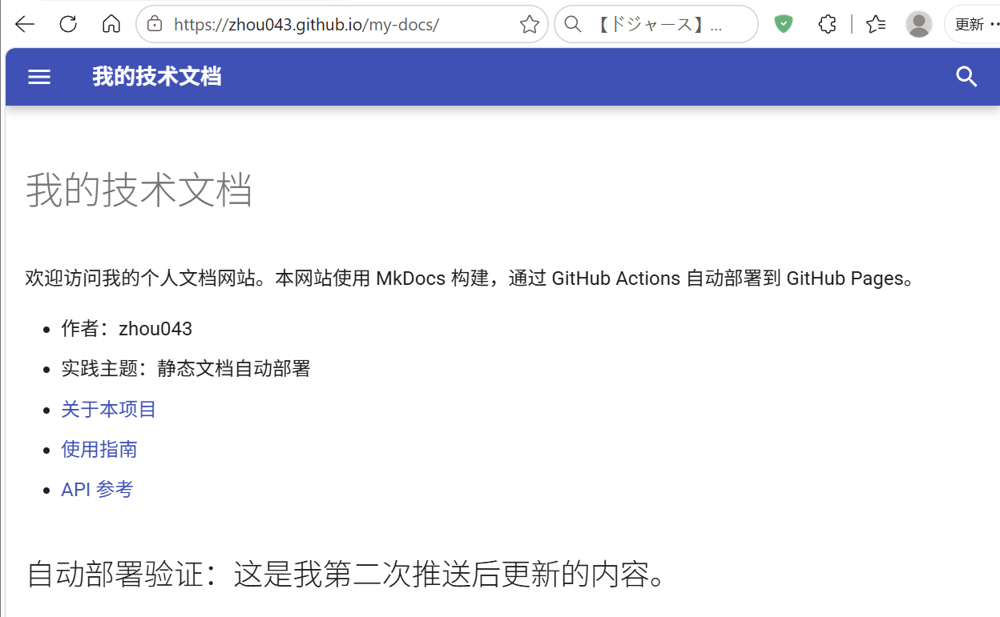

# 实践项目2：个人实验报告

## 1. 基本信息
- GitHub 登录名：zhou043
- 个人仓库地址：https://github.com/zhou043/my-docs
- 最终网站地址：https://zhou043.github.io/my-docs/

## 2. 实践过程与关键截图
### 2.1 仓库创建
登录 GitHub 后，通过右上角 `+` → `New repository` 创建仓库：Owner 选择本人账号 `zhou043`，仓库名填写 `my-docs`，可见性选择 **Public**，并勾选初始化 README。创建完成后确认默认分支为 `main`。

从截图可以看到，仓库所有者为 `zhou043`、仓库名为 `my-docs`，标题旁带有 `Public` 标识，当前分支为 `main`，仓库中已有 `Initial commit`。这说明公开仓库已经创建成功，后续的文档源码、工作流和实验报告都提交到这个仓库。



### 2.2 项目结构与 MkDocs 配置
截图左侧是 VS Code 中的项目目录，右侧是 `mkdocs.yml` 的内容。目录中已经建立 `docs/`、`report/`、`.github/workflows/`，以及 `mkdocs.yml`、`requirements.txt`、`.gitignore` 和根目录 `README.md`。



三个关键部分的作用如下：

- **`docs/`：网站内容的唯一来源。** 四页 Markdown（`index.md`、`about.md`、`guide.md`、`api.md`）都放在这里，MkDocs 只读取该目录下的源文件来生成网页。日常更新网站时，改这里即可，不需要接触生成后的页面。
- **`nav`：导航配置。** `mkdocs.yml` 中的 `nav` 决定导航栏显示哪些页面、以什么名称和顺序显示。其中路径是相对于 `docs/` 的，例如 `index.md` 实际对应 `docs/index.md`，不能写成 `docs/index.md`。没有登记在 `nav` 中的页面不会出现在导航里。
- **`site/`：构建产物目录。** 执行 `mkdocs build` 后，MkDocs 会把 Markdown、主题、样式和脚本生成到 `site/`，其中是可直接托管的 HTML、CSS、JS 等静态文件。它是自动生成的结果，已被 `.gitignore` 忽略，不提交到仓库；每次构建都会先清理再重新生成，因此不能靠手工修改 `site/` 来更新网站，正确做法始终是修改 `docs/` 后重新构建。

`mkdocs.yml` 中还配置了站点名称“我的技术文档”、`site_url`、GitHub 仓库地址，以及 `material` 主题和中文界面。构建依赖写在 `requirements.txt` 中，工作流会按该文件安装。

### 2.3 本地构建或预览
在仓库根目录先安装依赖，再执行严格构建和本地预览：

```bash
python -m pip install -r requirements.txt
python -m mkdocs build --strict
python -m mkdocs serve
```

截图显示 `mkdocs build --strict` 成功完成，日志为 `Cleaning site directory`、`Building documentation to directory: D:\OpenSource\my-docs\site`、`Documentation built in 0.36 seconds`；随后 `mkdocs serve` 启动，监听地址为 `http://127.0.0.1:8000/my-docs/`。构建过程中只有一条 Material 主题生命周期提示（提示该主题将于 2027 年 5 月停止维护），属于提示信息，不是错误，`--strict` 构建仍然通过。



我在浏览器中依次打开了四个页面并逐个检查：先看首页（`/my-docs/`），再看使用指南（`/guide/`）、关于（`/about/`）、API 参考（`/api/`）。终端日志中的四次 `Browser connected` 记录（19:40:47、19:41:46、19:42:02、19:42:12）与这四次访问对应。检查内容包括：

- 四个页面的标题和正文是否正常显示；
- 导航栏四项“首页、关于、使用指南、API参考”是否齐全、能否互相跳转；
- 首页“页面导航”表格是否正常渲染；
- 使用指南与 API 参考中的代码块、JSON 示例是否正常高亮；
- 页面之间的相对链接是否指向正确文件，主题资源和中文界面是否正常加载。

四页均显示正常，没有发现 404 或样式缺失。

### 2.4 Pages 设置
进入个人仓库的 `Settings` → `Pages` → `Build and deployment`，将 `Source` 选择为 **GitHub Actions**。截图显示发布来源已经切换为 GitHub Actions，页面同时给出了 Jekyll 和 Static HTML 的推荐工作流入口；本实践没有使用这些模板，而是使用自己编写的 `.github/workflows/deploy.yml`。同时在 `Settings` → `Actions` → `General` 中确认仓库允许运行工作流中的 Actions。



这样配置后，网站由工作流构建并发布，不需要创建 `gh-pages` 分支，也不需要把仓库默认权限改成全局读写，更不需要勾选创建或批准 PR 的权限。

### 2.5 Actions 首次构建和部署
第一次推送提交 `34e2349` 后，工作流运行失败（运行编号 #1，链接：https://github.com/zhou043/my-docs/actions/runs/41630887315）。失败原因不是配置内容有误，而是编辑 `deploy.yml` 后忘记保存，提交进去的是一个 0 字节的空文件，GitHub 无法解析这个工作流，运行记录没有生成任何 job（详见第 3 节）。

保存 `deploy.yml` 后重新提交 `a7e1deb` 并推送，第二次运行（编号 #2）成功：

- `build` 任务通过：检出源码、配置 Python 3.12、安装依赖、执行 `mkdocs build --strict` 并上传 `site/` 产物；
- `deploy` 任务通过：将构建产物发布到 GitHub Pages；
- 运行总时长 33 秒，其中 build 16 秒、deploy 9 秒，生成了 1 个 artifact；
- 部署地址为 `https://zhou043.github.io/my-docs/`。



首次成功运行的链接为：https://github.com/zhou043/my-docs/actions/runs/41631693855

### 2.6 网站访问与四页导航检查
部署完成后，在浏览器打开 `https://zhou043.github.io/my-docs/`。截图保留了地址栏，可以看到网站标题为“我的技术文档”，左侧导航包含“首页、关于、使用指南、API参考”四项，页面正文、表格、目录和 Material 主题样式均正常显示。



四页导航均已逐一检查：从首页进入关于、使用指南、API 参考，再返回首页，四个页面均可正常打开，导航高亮、页内目录、表格、代码块和页面间链接均无问题。检查结论：**四页导航已全部检查，无异常。**

### 2.7 第二次推送与自动更新验证
在 `docs/index.md` 中新增了一行容易辨认的文字：

```markdown
## 自动部署验证：这是我第二次推送后更新的内容。
```

提交 `9c4629e`（提交信息“验证文档修改后自动更新网站”）并推送到 `main` 后，没有点击任何手动部署按钮，工作流由这次 `push` 自动触发。运行记录（编号 #3）显示 `build` 和 `deploy` 均成功，总时长 1 分 22 秒，其中 build 14 秒、deploy 1 分 1 秒。



运行完成后刷新公开网站，首页正文下方出现了新增的“自动部署验证：这是我第二次推送后更新的内容。”，说明从修改 Markdown、推送到网站更新的整条自动部署链路已经生效。



- 对应提交链接：https://github.com/zhou043/my-docs/commit/9c4629e891cdc1338871ce6146dacf6694426bd7
- 对应 Actions 运行链接：https://github.com/zhou043/my-docs/actions/runs/41632491377

## 3. 问题与解决
**问题一：pip 安装依赖时出现代理错误。**

- 现象：执行 `python -m pip install -r requirements.txt` 时，命令反复输出 `WARNING: Retrying (Retry(total=4, connect=None, read=None, redirect=None, status=None)) after connection broken by 'ProxyError('Cannot connect to proxy.', ConnectionResetError(10054, '远程主机强迫关闭了一个现有的连接。', None, 10054, None))': /simple/mkdocs/`，依赖无法下载。
- 原因：本机当时开启了代理，pip 通过系统代理访问 PyPI 时无法连接到该代理，连接被重置。报错指向的 `/simple/mkdocs/` 说明失败发生在下载 mkdocs 包索引的阶段，而不是 `requirements.txt` 的内容有问题。
- 解决：关闭代理后重新执行 `python -m pip install -r requirements.txt`，依赖安装成功。之后 `mkdocs build --strict` 正常完成，说明依赖已经完整安装。

**问题二：第一次推送后 Actions 运行失败。**

- 现象：第一次推送提交 `34e2349` 后，Actions 中出现一条失败记录（编号 #1）。运行记录中没有生成 `build` 和 `deploy` 任务，页面无法展开具体的构建日志。
- 原因：在编辑器中写完 `deploy.yml` 后忘记保存，`git add` 提交的是空文件。用 `git cat-file -s 34e2349:.github/workflows/deploy.yml` 查看，该文件大小为 `0` 字节；没有 `name`、`on`、`jobs` 等内容，GitHub 无法解析这个工作流，因此只留下一条失败记录，连任务都无法创建。
- 解决：保存 `deploy.yml` 后重新提交 `a7e1deb`（该版本文件为 1203 字节），推送后运行编号 #2，`build` 与 `deploy` 均成功。

除上述两个问题外，我核对了构建日志、部署日志和 Pages 配置：`build` 日志中没有 `--strict` 产生的链接或导航告警，`deploy` 日志显示部署完成并给出 `https://zhou043.github.io/my-docs/`，Pages 的发布来源也始终是 GitHub Actions，没有出现分支发布相关错误。

## 4. 原理理解
1. **`docs/` 和 `site/` 各保存什么？为什么不用手工修改 `site/`？**
   `docs/` 保存 Markdown 源文件，是网站内容的唯一来源；`site/` 保存 `mkdocs build` 生成的静态网站产物（HTML、CSS、JS 等）。`site/` 每次构建都会先被清理再重新生成，手工修改会在下一次构建时被覆盖或删除；而且它已被 `.gitignore` 忽略，不进入版本控制。正确做法是修改 `docs/` 和 `mkdocs.yml`，再重新构建或推送，让工具生成新的 `site/`。

2. **本次工作流在什么情况下自动运行？**
   只有在向 `main` 分支推送，并且改动涉及 `docs/**`、`mkdocs.yml`、`requirements.txt` 或 `.github/workflows/deploy.yml` 时才会自动运行。其他路径（例如 `report/**` 和根目录 `README.md`）的修改不会触发。此外配置了 `workflow_dispatch`，可以在 Actions 页面手动运行。

3. **`build` 与 `deploy` 两个任务有什么区别？**
   `build` 负责准备和校验：检出源码、配置 Python、安装依赖、执行 `mkdocs build --strict`，并把 `site/` 作为 artifact 上传；它只读取仓库内容，不发布网站。`deploy` 通过 `needs: build` 依赖构建结果，只有构建成功才执行，负责在 `github-pages` 环境中把 artifact 发布到 Pages。这样拆分后，构建失败不会影响线上网站，部署任务也能只申请 `pages: write` 和 `id-token: write` 这两项必要权限，符合最小权限原则。

4. **只修改 `report/README.md` 会触发部署吗？为什么？**
   不会。工作流的 `push.paths` 只包含 `docs/**`、`mkdocs.yml`、`requirements.txt` 和 `.github/workflows/deploy.yml`，`report/README.md` 不在其中。GitHub Actions 会根据路径过滤决定是否运行，因此只改报告不会触发构建和部署。这也是预期行为：报告不属于网站内容，重新部署没有意义。

5. **本次方案为何无需创建 `gh-pages` 分支？**
   因为使用的是 GitHub 官方 Pages Actions 方案：`build` 任务用 `actions/upload-pages-artifact` 上传构建产物，`deploy` 任务用 `actions/deploy-pages` 直接把该产物发布到 Pages。Pages 的发布来源设置为 GitHub Actions，部署由工作流和 OIDC 令牌完成，不依赖某个分支存放生成文件。因此不需要 `gh-pages` 分支，也避免了维护分支、合并生成文件和手工推送产物等额外操作。
